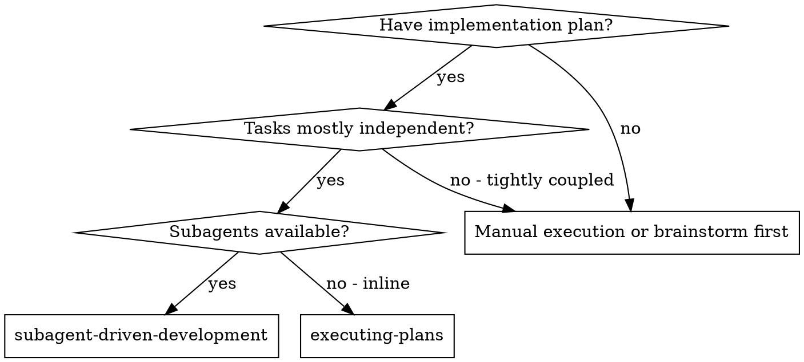
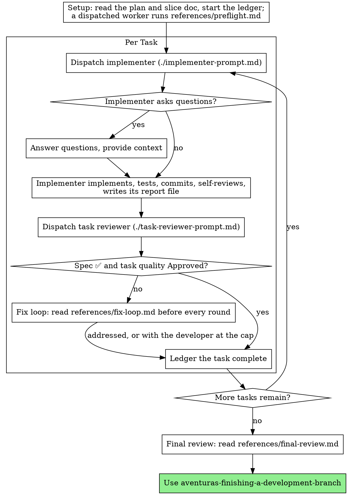

<!-- Adapted from Superpowers (https://github.com/obra/superpowers), MIT-licensed. See .agents/skills/NOTICE-superpowers.md. -->

# Subagent-Driven Development

Execute plan by dispatching a fresh implementer subagent per task, a task review (spec compliance + task quality) after each review-tier task, and a broad whole-branch review at the end. Automated-tier tasks are confirmed by running the plan's named verification commands instead (see Per-task verification tier).

**Why subagents:** You delegate tasks to specialized agents with isolated context. By precisely crafting their instructions and context, you ensure they stay focused and succeed at their task. They should never inherit your session's context or history — you construct exactly what they need. This also preserves your own context for coordination work.

**Core principle:** Fresh subagent per task + verification calibrated to the task's tier (a task review where it earns its cost) + broad final review = high quality, fast iteration

**Continuous execution:** Do not pause to check in with your human partner between tasks. Execute all tasks from the plan without stopping. The only reasons to stop are: BLOCKED status you cannot resolve, ambiguity that genuinely prevents progress, findings still open at the fix loop's cap, or all tasks complete. "Should I continue?" prompts and progress summaries waste their time — they asked you to execute the plan, so execute it. A dispatched worker never stops to ask a human; see Dispatched worker.

## Red Flags

**Never:**

- Start implementation on main/master branch without explicit user consent
- Skip the task review on a review-tier task, or silently substitute controller verification on a task the plan didn't mark automated (declare the tier — never swap it quietly)
- Accept a task review missing either verdict: spec compliance and task quality are both required
- Move to the next task while spec ❌, Critical or Important findings are open, unless they wait on the developer at the fix loop's cap
- Run a fix round without reading `references/fix-loop.md` first, or skip its scoped re-review
- Fix findings yourself in the controller session (context pollution, and the fix skips review)
- Rule yourself on a finding still open at the fix loop's cap
- Tell a reviewer what to flag or how severe a finding is, or drop a finding (see The task review)
- Dispatch multiple implementation subagents in parallel (conflicts)
- Make subagent read plan file (provide full text instead)
- Skip scene-setting context (subagent needs to understand where task fits)
- Ignore subagent questions (answer before letting them proceed)
- Accept "close enough" on spec compliance (reviewer found spec issues = not done)
- Let implementer self-review replace actual review (both are needed)

**If subagent asks questions:**

- Answer clearly and completely
- Provide additional context if needed
- Don't rush them into implementation

## When to Use

**vs. Executing Plans (inline):**

- Fresh subagent per task (no context pollution)
- Task review on review-tier tasks: spec compliance and task quality in one pass
- Faster iteration (no human-in-loop between tasks)

## Project code conventions

For code work, read [`docs/code-conventions.md`](../../../docs/code-conventions.md) — module structure (`lib/*` public-API rule), state placement, action layer, component taxonomy, testing — and check the [lessons-learned index](../../../docs/implementation/lessons-learned/README.md) before touching the substrate an entry references.

## The Process

## Setup

**Read one task at a time.** At the start, read the plan's header, Execution gate, Decisions, Global Constraints and Review Focus, its task list (each task's heading, tiers and Files block), and the slice doc's Scope and Acceptance criteria: that is the context you curate each dispatch from and settle conflicts against. Read a task's full text when you reach it and paste it into the dispatch. Plans written in batches run to twice the old length, and holding every task's text from the start fills your context before the first task.

**Keep a ledger, attended or dispatched; your context can be compacted at any point.** Create `<plan-stem>.worker.md` next to the plan file. You are its only writer. Write each entry before moving on, not at the end:

- header: slice, branch, worktree
- per task, each line starting `Task <N>:`: `dispatched <base-sha> <implementer agent ID>`, `implemented <sha>`, `review <sha>: spec ✅|❌, quality Approved|Needs fixes`, `minor (deferred): <one-liner>`, the fix loop's lines, `complete`; or `blocked: <reason>`, with any partial commits
- `settled: <what> — <why> — <cost if wrong>` for each conflict you decide yourself; the PR lists these
- per question: the text, before you send it; its message ID whenever the channel returns one (a timeout does; an answer that arrives in time may come without one); then the answer with its label
- the final review's lines (`references/final-review.md`)
- review-round entries (aventuras-receiving-code-review) and the PR URL

**At start and after any compaction, resume from the ledger,** checked against `git log`. A task without `complete` is not complete; one whose last line is a fix round with findings open resumes the loop at the next round, or goes to the cap after round 5; one whose last round left none open is complete. A question with a message ID and no answer is still open: resume it with the channel's resume form. Never ask it again; if the ID is missing, find the question through the channel before asking anything.

**A dispatched worker sweeps the plan before Task 1:** read [references/preflight.md](references/preflight.md) and run it.

## Per-task verification tier

The per-task loop above is the **`review`-tier** flow. Each task's tier comes from the plan (writing-plans assigns a `Verification:` tier); honor it:

- **`review`** — run the full loop: implementer → task reviewer → fix rounds, each with a scoped re-review → complete.
- **`automated`** — the acceptance is fully covered by deterministic gates. Skip the task reviewer; instead **run the task's named verification commands yourself and report the evidence** (the actual command output, not "looks fine"). The implementer's self-review stands in for the spec verdict. If a runtime-only risk was flagged, record it as a smoke / monitor rather than treating it as covered.

The **final whole-branch review runs regardless of tier** — it is the backstop for cross-task and holistic issues. Substituting controller verification is legitimate **only** when the plan marks the task `automated`; doing it on a `review`-tier task, or without the plan saying so, is the silent-skip red flag above.

## Model Selection

**The model tier is set per task in the plan** (writing-plans assigns each task a `Model:` tier). Dispatch every task at its assigned tier — pass it as the `model` of the `aventuras-implementer` dispatch: `cheap` → haiku, `standard` → sonnet, `capable` → opus. If the plan predates this field or omits it, assign a tier using the signals below and state it in the dispatch; do not silently inherit the controller's model. (Mechanical work running on the most capable model — the costly default this prevents — is the common failure.)

**Effort is set by the agent definitions, not per dispatch:** the implementer runs at `high` (Haiku has no effort setting), the task reviewer and the code reviewer on Opus at `xhigh`. A subagent dispatched without a definition inherits your session's effort.

Use the least powerful model that can handle each role to conserve cost and increase speed.

**Mechanical implementation tasks** (isolated functions, clear specs, 1-2 files): use a fast, cheap model. Most implementation tasks are mechanical when the plan is well-specified.

**Integration and judgment tasks** (multi-file coordination, pattern matching, debugging): use a standard model.

**Architecture, design, and review tasks**: use the most capable available model.

**Task complexity signals:**

- Touches 1-2 files with a complete spec → cheap model
- Touches multiple files with integration concerns → standard model
- Requires design judgment or broad codebase understanding → most capable model

## Handling Implementer Status

Implementer subagents write their full report to the report file and reply with a short status: DONE, DONE_WITH_CONCERNS, NEEDS_CONTEXT or BLOCKED.

**DONE:** First check the report file's Failing tests field: a test named there goes through [references/handling-reports.md](references/handling-reports.md) → failing tests. Then verify by the task's tier: a `review` task gets the task reviewer; an `automated` task gets its named commands, run by you.

**Any other status:** read [references/handling-reports.md](references/handling-reports.md) and follow it, every time you get one. It holds how a conflict between the task and canon or the code is settled: by canon, by the code, or by your human partner.

## The task review

Dispatch it with [task-reviewer-prompt.md](task-reviewer-prompt.md): the task's full text, every answer that changed it, the Global Constraints, the plan's Decisions, the report file's path and the task's range. A dispatch carries what the task needs and nothing about what to find:

- Do not add open-ended directives like "check all uses" or "run race tests if useful" without a concrete, task-specific reason
- Do not pre-judge findings for the reviewer — never instruct a reviewer to ignore or not flag a specific issue. If you believe a finding would be a false positive, let the reviewer raise it and let the fix loop settle it. If the prompt you are writing contains "do not flag," "don't treat X as a defect," "at most Minor," or "the plan chose" — stop: you are pre-judging, usually to spare yourself a review loop.
- One carve-out: paste every answer that changed the task, quoted with its label. It is part of the task; free-text guidance on what to flag is not.
- Drop no finding: every spec ❌ item and Critical or Important finding enters the fix loop, and only the loop's own routes take one out.

A ⚠️ item (cannot verify from this task's code) doesn't block the rest of the review, but resolve each one yourself before marking the task complete: you hold the plan and the cross-task context the reviewer lacks. One you confirm as a real gap is a failed spec verdict.

Whatever the verdicts, ledger each Minor finding as `minor (deferred)` for the final review, and route Outside this change to `docs/implementation/triage.md` without holding the task. The fix loop triggers when the review reports spec ❌, any Critical or Important finding, or a ⚠️ item you confirmed as a real gap. Read [references/fix-loop.md](references/fix-loop.md) and follow it. Read it again before every round, even if you read it earlier in this session: it holds the round cap, what happens at the cap, and the ledger line each round writes, and your memory of it does not survive compaction. Minor findings never enter the loop.

## Final Review

When every task is complete and no question is open, read [references/final-review.md](references/final-review.md) and follow it. It covers the whole-branch review, its single fix wave, and where residual findings go.

## Dispatched worker

You are a **dispatched worker** when your task prompt says so and names an escalation channel: a command that sends a question to a coordinator and blocks until it answers. Nobody watches your terminal. Everything this skill and the skills it calls send to "your human partner" or "the human" goes through that channel instead. Never open an interactive question prompt; nobody can answer it and the run hangs.

**The plan is read-only.** Read it by the absolute path your prompt gives. Never edit it, checkboxes included.

**Before asking,** finish any in-flight review loop of an implemented task, and sweep the remaining tasks for the same issue so one question covers it. Give the coordinator what it needs to answer without your context: slice and task, the conflict quoted from the plan and the doc it cites, the options, and which later tasks depend on the answer.

**While a question is open, keep going with the tasks that don't depend on it,** in plan order. When such tasks remain, send the question with a short timeout, about a minute: the timeout hands back its message ID and the question stays open. Ledger each task you pass over as `held: <question>`. Between tasks, never in the middle of one, check for the answer with the channel's resume form and the same short timeout. Wait on the channel with its full timeout, resuming after each one, only when every remaining task depends on an open question. The final review and the finish wait until no question is open.

**Never stop between tasks.** Nobody is at the terminal to say "continue": a worker that ends its turn to wait for input stalls until someone notices. Stop only after reporting completion, or while waiting on the channel.

**At a usage limit, wrap up as the note asks.** When Claude Code says your usage limit is reached, finish the step in hand, ledger it, and end your turn. Send no worker_done and no escalation for it: the worker setup resumes you after the limit resets, and you continue from your ledger.

**Answers come labelled.** Record the label with the answer. An answer that overrides the plan goes, quoted with its label, into every later implementer and task-reviewer prompt it touches; otherwise the reviewer flags it as a deviation.

| Label          | Meaning                                  | Ends up in                                                    |
| -------------- | ---------------------------------------- | ------------------------------------------------------------- |
| `ANSWER:`      | settled by the plan, slice doc or canon  | nothing extra                                                 |
| `PROVISIONAL:` | a reversible choice the coordinator made | the PR's Decisions pending                                    |
| `DEVELOPER:`   | the developer decided                    | the PR's decisions list, the slice doc's Implementation notes |

**Finish** with aventuras-finishing-a-development-branch; its Dispatched worker section replaces the options menu. A plan whose Execution gate splits the slice into stacked PRs finishes PR by PR: at each PR's last task, follow its Stacked PRs section for that PR, then carry on with the next PR's tasks on the next branch.

## Agents and Prompt Templates

Each subagent role is a Claude Code agent definition in `.claude/agents/`, which sets its model and effort. The templates here are the per-dispatch part:

- `aventuras-implementer` with `./implementer-prompt.md` - implementer, and the fixer in fix rounds and after the final review
- `aventuras-task-reviewer` with `./task-reviewer-prompt.md` - the task review; with `./re-review-prompt.md` - each scoped re-review
- `aventuras-code-reviewer` with aventuras-requesting-code-review's template - the final whole-branch review

Without Claude Code agent definitions (another harness), dispatch a general subagent whose prompt is the definition file's body followed by the per-dispatch prompt; its model and effort then follow that harness's controls.

## Integration

**Required workflow skills:**

- **aventuras-using-git-worktrees** - Ensures isolated workspace (creates one or verifies existing)
- **aventuras-writing-plans** - Creates the plan this skill executes
- **aventuras-requesting-code-review** - The final review's dispatch template
- **aventuras-finishing-a-development-branch** - Complete development after all tasks

**Subagents should use:**

- **aventuras-test-driven-development** - Subagents follow TDD for each task

**Alternative workflow:**

- **aventuras-executing-plans** - Use to execute the plan inline in this session, without a subagent per task
